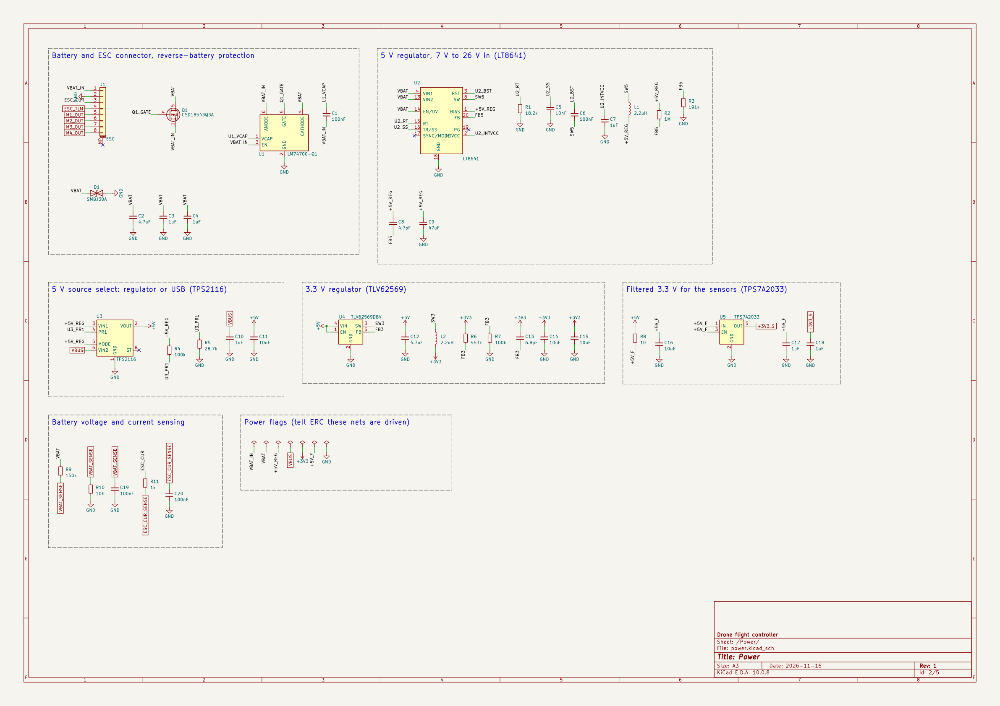
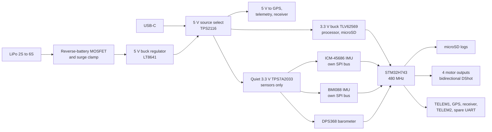
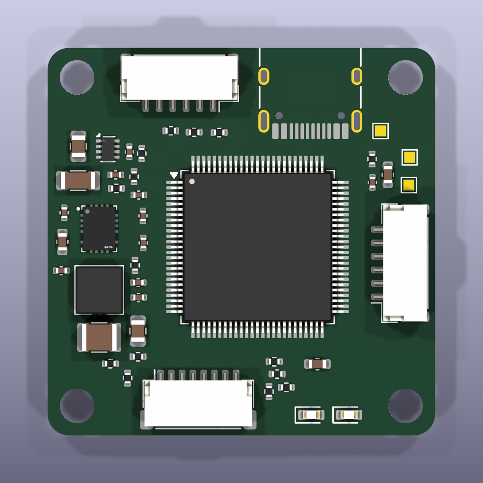
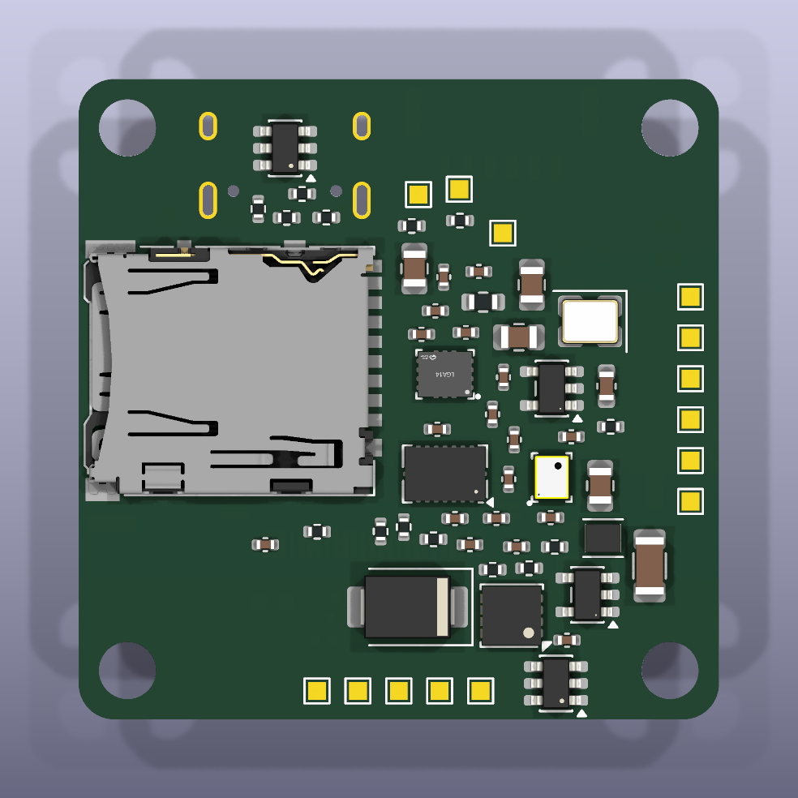

# Drone flight controller

**The circuit design of an ArduPilot flight controller for a quadcopter: STM32H743 processor, two motion sensors from two makers, a barometer and microSD logging, drawn in KiCad 10 and checked by KiCad and by ArduPilot's own tools. Schematic finished; board layout not finished; not built.**


<p align="center">
  
</p>
<p align="center"><em>The power sheet of the schematic. Every block has a title saying what it does. All four sheets: <a href="docs/schematic.pdf">docs/schematic.pdf</a>.</em></p>

## In plain words

A flight controller is the small computer at the centre of a drone. Hundreds of times a second it reads motion sensors, works out how the drone is tilted and moving, and sets each motor's speed to keep it steady. I designed the circuit of one from a blank page: chose every part, worked out the power supply from the datasheets, planned every processor pin so ArduPilot can use it, and drew the schematic. Each step has a check that a reader can run.

## Results at a glance

| Check | Result | Source |
| --- | --- | --- |
| KiCad electrical rules check (ERC) | **0 violations** | `reports/kicad/erc.json` |
| Schematic compared pin by pin with the circuit description | **0 mismatches** over 110 parts and 81 nets | `reports/hardware/netlist_check.md` |
| ArduPilot's board-file processor: every peripheral gets DMA, sensors and motors on their own streams | **pass** | `reports/firmware/hwdef_check.md` |
| Battery range covered | **6.0 to 25.2 V** (2S empty to 6S full) | `reports/design_calcs.md` |
| Parts cost per board (LCSC single-unit prices) | **$55.38**, 93 parts of 45 types | `reports/hardware/cost.md` |

## The problem

A flight controller has to measure tiny rotations while motors a few centimetres away shake the frame and draw tens of amps from the same battery, run from anything between a nearly flat 2-cell and a full 6-cell pack, and drive the motors with precise digital timing. The processor's pin choices decide what the firmware can do. Most hobby boards publish only the files; this repo also keeps the reasoning and the checks.

## The design



The main choices, each in one line (details and alternatives in [docs/DECISIONS.md](docs/DECISIONS.md)):

- **Two motion sensors from two makers on separate SPI buses**, so a fault on one bus cannot stall the other and ArduPilot can compare them.
- **A buck regulator for the processor's 3.3 V.** The calculation showed a small linear regulator would reach 155 °C at typical load, above its 150 °C limit.
- **A separate quiet 3.3 V supply for the sensors**, behind an RC filter, so switching noise stays out of the measurements.
- **Battery sense divider of 150 kΩ / 10 kΩ**, so the processor's analog pin stays in range even at the surge clamp voltage (full scale 52.8 V).
- **The pin map starts from a flying ArduPilot board** (Matek H743) and is changed only where this board differs, then checked with ArduPilot's own tool.

The schematic is generated from one Python file, `hardware/gen/circuit.py`, which lists every part, value, footprint, LCSC number and pin net. That keeps every connection reviewable as text: change a line, regenerate, and the checks run again. How each piece works is explained, with interview-style questions, in [docs/LEARNING.md](docs/LEARNING.md).

## What a board would cost

| Way to get one | Cost per board | Source |
| --- | --- | --- |
| Build it at JLCPCB: 2 assembled (plus 3 bare), E-POST shipping | $159.12 | `reports/hardware/cost.md` |
| Build it at JLCPCB: 5 assembled, E-POST shipping | $102.21 | `reports/hardware/cost.md` |
| Buy a Holybro Kakute H7 V2 (same processor, one IMU) | $52.00 | `reports/hardware/cost.md` |

Most of the difference is JLCPCB's fixed assembly fees ($152.81, the same for 2 boards or 20, `reports/hardware/cost.md`), which a factory spreads over thousands of boards. So this board is not about price: it shows the design work. For flying, a ready-made board is the cheaper choice.

## Board layout: where it stands

<p align="center">
  
  
</p>
<p align="center"><em>Placement study, top and bottom (KiCad render). The parts fit on a 36 x 36 mm board with 30.5 mm mounting, but the tracks are not routed.</em></p>

The parts are placed on both sides of a 36 x 36 mm, 4-layer board, but routing is not finished. An autorouter (Freerouting) left connections open and cut into the ground layer the sensors need, so the board was not released. The placement and routing scripts are in [hardware/gen/](hardware/README.md); the lessons are in [docs/LEARNING.md](docs/LEARNING.md), section 13. Finishing it means hand routing, or a 6-layer board at a higher price (decision D31).

## How to check it yourself

```bash
git clone https://github.com/Adan-Khalid/drone-flight-controller.git
cd drone-flight-controller
uv sync --group dev
uv run pytest                               # calculations and circuit tests
uv run python scripts/design_calcs.py       # power supply and signal calculations
uv run python scripts/check_hwdef.py        # ArduPilot pin and DMA check
uv run python scripts/bom_cost.py           # BOM and cost estimate
bash scripts/kicad_checks.sh                # ERC (needs KiCad 10)
```

Open the schematic in KiCad 10: `hardware/kicad/dronefc.kicad_pro`.

## Data

No dataset. Facts come from part datasheets, JLCPCB's and LCSC's pages and ArduPilot's source; each one is listed with its link in [docs/RESEARCH_LOG.md](docs/RESEARCH_LOG.md).

## Limitations and next steps

- Not built and not tested. Every number above is a calculation or a check, not a measurement.
- The board layout is not finished (see above). Next: route by hand in KiCad, or move to 6 layers.
- The KiCad simulations of the battery divider and sensor filter ([docs/SIMULATION_GUIDE.md](docs/SIMULATION_GUIDE.md)) are not run yet.
- To keep a 4-layer board possible, the CAN port, motor outputs 5 to 8 and the buzzer were dropped (decision D31): this is a quadcopter controller.
- A design for learning and research. It is not certified and must not be used where people could be hurt.

## Tools used

| Tool | Where it shows |
| --- | --- |
| KiCad 10 (schematic, ERC, 3D render) | `hardware/kicad/`, `reports/kicad/erc.json`, `assets/` |
| Python generators for KiCad files | `hardware/gen/circuit.py`, `hardware/gen/build_schematic.py`, `hardware/gen/check_netlist.py` |
| ArduPilot board definition and its DMA tool | `firmware/hwdef/DroneFC-H743/`, `scripts/check_hwdef.py` |
| Datasheet calculations in Python | `src/fcboard/`, `scripts/design_calcs.py`, `tests/test_calcs.py` |
| BOM and cost from LCSC data | `scripts/bom_cost.py`, `reports/hardware/cost.md` |
| pytest, ruff and GitHub Actions | `tests/`, `.github/workflows/ci.yml` |

## Licence and citation

Hardware: CERN-OHL-P-2.0. ArduPilot board files: GPL-3.0-or-later. Scripts: MIT. Documentation and figures: CC BY 4.0. Details in [LICENSE.md](LICENSE.md); to cite, see [CITATION.cff](CITATION.cff).
