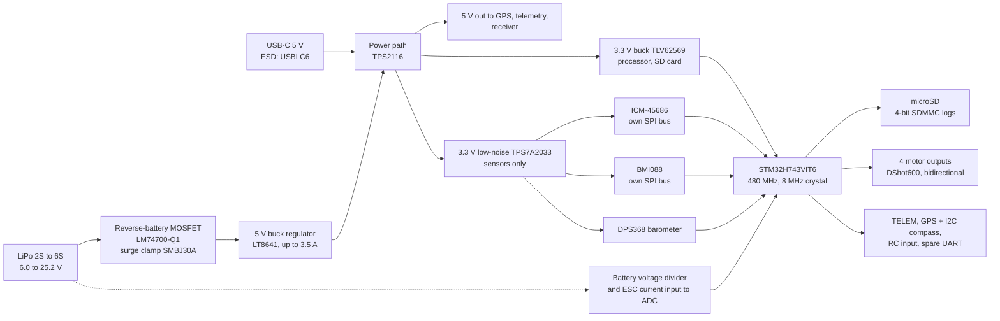

# Project plan

Status: draft for review, 15 Nov 2026. Nothing here is a measurement yet. Every number in the final README will come from a file in `reports/` made by a script in this repo, or from a bench test logged in `docs/TEST_REPORT.md` with the instrument used. Sources for every fact below are in `RESEARCH_LOG.md` and `PARTS_SHORTLIST.md`.

## 1. Problem and users

A flight controller is the computer at the centre of a drone. It reads motion sensors (gyroscope and accelerometer) at kilohertz rates, estimates the drone's attitude and position, and sets each motor's speed so the drone stays where the pilot or the mission wants it. Getting this right on a circuit board is a real electronics problem:

- The motion sensors must measure tiny rotations while four motors a few centimetres away shake the frame and draw tens of amps from the same battery.
- The board runs from a flight battery that can sit anywhere between a nearly flat 2-cell and a fully charged 6-cell pack, with voltage spikes when motors brake.
- Motor commands (DShot) need hardware timers with DMA, so pin choices on the processor decide what the board can do.
- The firmware (ArduPilot) must be told exactly how the board is wired before it will run.

**Users of the result:** the people who read the repo (recruiters and engineers judging hardware design skill) and my later drone projects that need a real flight controller (trajectory tracking, sensor fusion, drone audition).

**What is new here:** not the idea of a flight controller (many exist). What this repo adds is the full engineering record that most hobby boards skip: written requirements, a pin plan checked against ArduPilot's timer and DMA rules, datasheet calculations and simulations in KiCad compared with scope measurements on the real board, automatic ERC and DRC checks on every change, a documented ArduPilot port, and a test report from bench to hover. The same board is then redrawn in Altium Designer.

## 2. Limits (stated in the README)

- A first prototype for learning and research. Not certified, not for carrying people, not for flying over people or for any safety-critical use.
- Flight tests only where Pakistani law allows and with the permissions it requires (see `RESEARCH_LOG.md`, section on rules). Props off for all bench tests.
- LiPo batteries are charged on a proper balance charger, never left unattended, and never connected to the board on the bench without a current limit or a fuse.
- Tested on one quadcopter. Results do not transfer to other frames without new tuning.

## 3. Non-goals

- No custom flight-control software: the board runs ArduPilot unchanged except for the board definition.
- No on-board video, OSD or radio link: those connect as external modules.
- No ESC (motor driver) on this board: motors are driven by an external 4-in-1 ESC.
- No novelty claim.

## 4. Architecture

| Block | Design decision | Why |
| --- | --- | --- |
| Input protection | Ideal-diode MOSFET for reverse battery, 30 V TVS for surges | A reversed plug or a motor-braking spike must not kill the board; a diode would waste power |
| 5 V regulator | LT8641 synchronous buck at 2 MHz, chosen over two cheaper TI parts for heat, size and current margin | Covers 6.0 to 26.7 V with margin (65 V rating) and powers every peripheral |
| Power path | TPS2116 priority switch between battery-fed 5 V and USB | Bench work on USB alone; no back-feeding into the computer when both are connected |
| Two 3.3 V rails | Small buck (TLV62569) for the processor and SD card; separate very low-noise LDO (TPS7A2033) behind a ferrite and capacitor filter for the sensors | An LDO for the processor would overheat (0.6 W, 155 °C at 45 °C ambient; see `reports/design_calcs.md`); the sensors draw only 6.6 mA, so their LDO stays cool and keeps processor current steps and switching ripple out of the sensor supply |
| Processor | STM32H743VIT6 with 8 MHz crystal | Full ArduPilot feature set, existing reference pin maps, crystal frequency ArduPilot expects |
| Motion sensors | ICM-45686 and BMI088 on separate SPI buses, at the board centre, away from the regulator | Two independent EKF inputs from two makers; centre placement follows ArduPilot's mounting advice |
| Barometer | DPS368 on the sensor supply | In stock, ArduPilot driver, sealed package; placement and any cover follow ArduPilot's mounting guidance, read before layout |
| Logging | microSD on 4-bit SDMMC | Unlimited logs for the noise and vibration analysis |
| Outputs | 4 outputs on timers with DMA, all to the ESC connector; outputs 1 to 4 bidirectional DShot for RPM-based notch filtering (outputs 5 to 8 removed, DECISIONS D31) | ArduPilot's DMA rules decide which pins can do this; checked in CubeMX and by compiling the board file |
| Connectors | JST GH with Pixhawk DS-009 pinouts for TELEM1 and GPS (with I2C); JST SH 8-pin for a 4-in-1 ESC; solder pads for the receiver, TELEM2, GPS2 and the serial LED; SWD pads | Standard cables fit; one-cable ESC connection |
| Board | 4 layers (signal, ground, power, signal), 36 x 36 mm, 30.5 mm M3 mounting, 1.6 mm, ENIG finish | Solid ground under the sensors; standard hobby frame mounting; flat pads for the LGA sensors |

## 5. Requirements

Each requirement has a target and the test that proves it. "Design target" means my own engineering choice, not a figure from a standard.

| ID | Requirement | Target | How it is verified |
| --- | --- | --- | --- |
| R1 | Battery input | Works from 6.0 to 25.2 V (2S empty to 6S full, computed from 3.0 and 4.2 V per cell); survives 26.7 V (6S high-voltage) and a reversed battery | Datasheet calculations at 6.0, 25.2 and 26.7 V (`reports/design_calcs.md`); bench supply sweep with current limit; reverse-polarity test at low current limit |
| R2 | 5 V supply | 2 A continuous to peripherals; ripple below 50 mV peak-to-peak at 2 A (design target); recovers from a 0.2 to 2 A step | Calculated ripple and soft-start time; scope measurement of ripple and a load step; compared in one figure |
| R3 | Sensor supply | 3.3 V from a separate LDO with at least 90 dB rejection at 1 kHz (datasheet: 95 dB) | KiCad simulation of the filter network plus datasheet PSRR; scope on the rail in a motor test |
| R4 | USB operation | Board runs and flashes from USB-C alone; switches to battery without resetting | Bench: plug and unplug with battery connected, check for resets in the ArduPilot log |
| R5 | Firmware | ArduPilot Copter builds for this board with scripting and FFT notch present; bootloader flashes over USB DFU | Build in WSL2 before ordering; `features.txt`; first flash on the bench |
| R6 | Motion sensors | Both detected; gyro noise density at rest within 2x of the datasheet value (design target): ICM-45686 3.8 mdps/√Hz, BMI088 0.014 °/s/√Hz | 60 s log at rest, raw IMU logging, Welch spectrum, compared with the datasheet line |
| R7 | Barometer | Detected; height noise at rest reported in cm | 60 s log at rest |
| R8 | Motor outputs | 4 outputs (5 to 8 removed, D31); DShot600 frames with correct bit timing (600 kbit/s gives a 1.67 µs bit, computed); RPM telemetry from a bidirectional DShot ESC on outputs 1 to 4 | Scope capture; props-off motor test with ESC RPM shown in Mission Planner |
| R9 | Ports | TELEM1 with flow control, GPS with I2C, RC input (CRSF or SBUS), TELEM2, spare UART, USB, SWD (CAN removed, D31) | Loop-back or device test on each port |
| R10 | Battery monitoring | Battery voltage error within 2 % from 6 to 25 V (design target); ESC current input read | Compare ArduPilot reading with a multimeter at 5 voltages |
| R11 | Logging | microSD logs at Copter's 400 Hz loop with no gaps over a 10-minute test | Log analysis script |
| R12 | Size and assembly | 36 x 36 mm, 30.5 mm mounting, under 10 g (design target); parts on one side if possible so JLCPCB's Economic assembly applies; every part in stock | KiCad board outline; scale; JLCPCB BOM check |
| R13 | Design checks | ERC and DRC clean with JLCPCB's limits (0.09 mm trace and space on 4 layers, 0.15 mm annular ring minimum) | `kicad-cli` in CI on every push |
| R14 | Flight | Steady 2-minute hover; vibration (VIBE) below 30 m/s² and no accelerometer clipping, ArduPilot's guidance; EKF cores agree within a few degrees | Flight log analysis; only after registration and in legal airspace |

## 6. Verification plan

### Before ordering (proves the design on paper)

| Check | Tool | Pass condition |
| --- | --- | --- |
| Pin plan has no conflicts; clock tree reaches 480 MHz from 8 MHz; USB gets 48 MHz | STM32CubeMX | no red pins; clock tree valid |
| DMA allocation for the board file | ArduPilot's `chibios_hwdef.py` at a pinned commit (`scripts/check_hwdef.py`, also in CI) | no unresolved DMA; IMU buses and motor timers on their own streams (done: pass) |
| Board file compiles | ArduPilot build (WSL2) | `waf copter` succeeds; `features.txt` lists scripting and FFT |
| Regulator: frequency limits, ripple, current limit, inductor, soft-start, conduction loss from 6.0 to 26.7 V | `scripts/design_calcs.py` with the LT8641 datasheet equations | R1 and R2 targets met with margin (done: `reports/design_calcs.md`) |
| Sensor supply filter (ferrite and capacitors before the LDO) | KiCad simulator (AC analysis) | attenuation at the buck switching frequency reported |
| Battery divider and filter feeding the ADC, including ADC sampling time | Python calculation (done) and KiCad simulator (transient with the sample capacitor) | settles within the sampling window; full scale covers 26.7 V |
| DShot600 edge through the output resistor and a 10 cm wire into the ESC | KiCad simulator (transient) | rise time well below the 1.67 µs bit |
| Trace widths for 2 A, USB pair impedance on JLCPCB's 4-layer stack-up | KiCad calculator, JLCPCB impedance calculator | values recorded in `reports/design_calcs.md` |
| Electrical and layout rules | `kicad-cli sch erc`, `pcb drc` in CI | zero errors; any waived warning explained |
| Design review | `docs/DESIGN_REVIEW.md` checklist (power, clocks, decoupling, sensor placement, SDMMC, USB, connectors, test points, silkscreen) | every item ticked or explained |

### After the boards arrive (bench, then flight)

1. Visual inspection under magnification; resistance from each rail to ground before first power.
2. First power from a bench supply at 12 V with the current limit set low; measure 5 V and both 3.3 V rails.
3. Idle current at 7.4 V and 25.2 V.
4. 5 V ripple and load step on the oscilloscope with a resistive or electronic load; compare with the calculated values.
5. USB: DFU mode, bootloader, ArduPilot; connect Mission Planner.
6. Sensors detected; calibrate; 60 s rest log for noise; barometer noise.
7. Battery voltage reading against a multimeter at 5 points.
8. Motor outputs on the scope (PWM and DShot600); props-off motor test with a bidirectional DShot ESC; RPM telemetry.
9. Logging test, 10 minutes.
10. Regulator temperature after 10 minutes at 2 A (IR thermometer).
11. Flight, only after registration and only in legal airspace (indoors in a covered space first, or outdoors under rule 18): hover, vibration, FFT with and without the harmonic notch, EKF agreement.

Equipment: bench supply with current limit, oscilloscope, multimeter, load resistors or an electronic load, IR thermometer (NUST lab, to be confirmed); a debug probe (ST-LINK or a Raspberry Pi Pico running debugprobe) for bring-up.

## 7. Cost estimate (estimate only, not a quote for the finished design)

Prices read on 15 Nov 2026 from the JLCPCB instant quote, JLCPCB's assembly price page and LCSC/JLCPCB part listings (see `RESEARCH_LOG.md` and `PARTS_SHORTLIST.md`). The real price is known only after uploading Gerbers and the BOM.

| Item | Basis | Estimate (USD) |
| --- | --- | --- |
| 5 bare boards, 4 layers, 36 x 36 mm, 1.6 mm, ENIG | JLCPCB instant quote | 24.70 |
| Economic assembly setup and stencil, 2 boards assembled | $8.18 + $1.53, assembly price page | 9.71 |
| Extended-part loading fee | about 20 part types (my count from the shortlist) x $3.07 | 61.40 |
| Main parts for 2 boards | 2 x $50.87 (sum of the priced parts in the shortlist; JST 4-pin prices used as a stand-in for 6- and 8-pin versions) | 101.74 |
| Shipping to Pakistan | DHL Express, quote for 0.15 kg | 35.46 |
| **Total for 2 assembled boards plus 3 bare boards** | computed | **about 233** |
| Cheaper variant | OSP finish ($8.00) and E-POST shipping ($11.69, 10 to 21 days) | about 193 |
| All 5 boards assembled | add 3 x $50.87 in parts | about 386 |

Not included: crystal, MOSFET, microSD socket, inductor, passives and LEDs (to be priced in the BOM step; most passives are cheap Basic parts); JLCPCB minimum-quantity or spare-part extras; customs duty and taxes in Pakistan; any registered-importer charge (see risks); debug probe; the test quadcopter (frame, motors, 4-in-1 ESC, propellers, LiPo and charger, radio, GPS with compass), which depends on what is already available.

## 8. Risks

| Risk | Likelihood | Effect | What I do about it |
| --- | --- | --- | --- |
| Pakistani rules: importing a "part of an unmanned aircraft" needs a registered importer (rule 41); a design or manufacture "facility" needs a certificate (rule 33); every drone must be registered (rule 4) | unknown | order held at customs or not allowed; flight not legal | Ask PCAA or the NUST department before ordering; consider ordering through NUST; register the test drone before any outdoor flight; bench and indoor tests first |
| A part goes out of stock between design and order (ICM-42688-P and the H743 tray part already show 0) | medium | redesign or delay | Shortlist alternatives; check stock again at the BOM step and the day of ordering; footprints shared with alternatives where possible |
| Processor bring-up fails (power pins, VCAP capacitors, crystal, BOOT0) | medium | board does not start | Follow ST's datasheet and the Pixhawk 6C pin map; SWD pads and test points; design review item for every power pin |
| DShot or bidirectional DShot not possible on some outputs because of DMA limits | medium | fewer RPM-filtered motors | Check in CubeMX and by compiling the ArduPilot board file before ordering |
| SD card does not work (it failed on a 2026 student H743 board) | medium | no logs | Follow the reference SDMMC wiring; review item; W25N01GV kept as a fallback |
| Switching noise or vibration reaches the motion sensors | medium | noisy gyro, poor flight | Separate low-noise LDO; regulator far from the sensors; solid ground plane; soft-mount the board; measure and report honestly |
| Single-sided Economic assembly does not fit on 36 x 36 mm | medium | higher assembly cost ($51.12 setup for double-sided) | Try single-sided placement first; otherwise grow the board or accept double-sided |
| Customs delay or extra charges | medium | waiting weeks | DHL is faster; plan the Altium redraw for the waiting time |
| Damage during first power or motor tests; LiPo fire | low to medium | lost board; injury | Current-limited supply, props off, a fuse or smoke stopper on the battery, LiPo charged on a balance charger in a safe bag |
| Altium runs slowly on this laptop (i7-10610U, 15.7 GB RAM; Altium recommends a 12th-gen i7 and 32 GB, minimum i5 and 4 GB) | medium | slower redraw | Meets the minimum; the redraw is the second tool, not on the critical path |
| ArduPilot does not accept the board upstream (student projects are a listed rejection reason) | high | board stays in my fork | Expected; the board file lives in this repo and builds from a fork |
| The STM32H743 chips delivered are silicon revision Y, which ST rates to 400 MHz instead of 480 MHz (DS12110) | unknown | slightly lower processor speed | ArduPilot runs on both; read the revision at bring-up and record it |
| Regulators run hotter than calculated (the calculations count only switch conduction loss) | medium | thermal shutdown in hot weather | Ground pours and thermal vias under the LT8641; measure temperature at 2 A on the bench before flying in summer |

## 9. Steps

The ordered steps, who does each, and what each produces are in `TASKS.md`. Schematic capture, layout, the pin plan, the Altium redraw and all hands-on hardware work are done by me in the GUI tools; calculations, simulations, reviews, the ArduPilot board file and documentation are scripted and checked in this repo.
